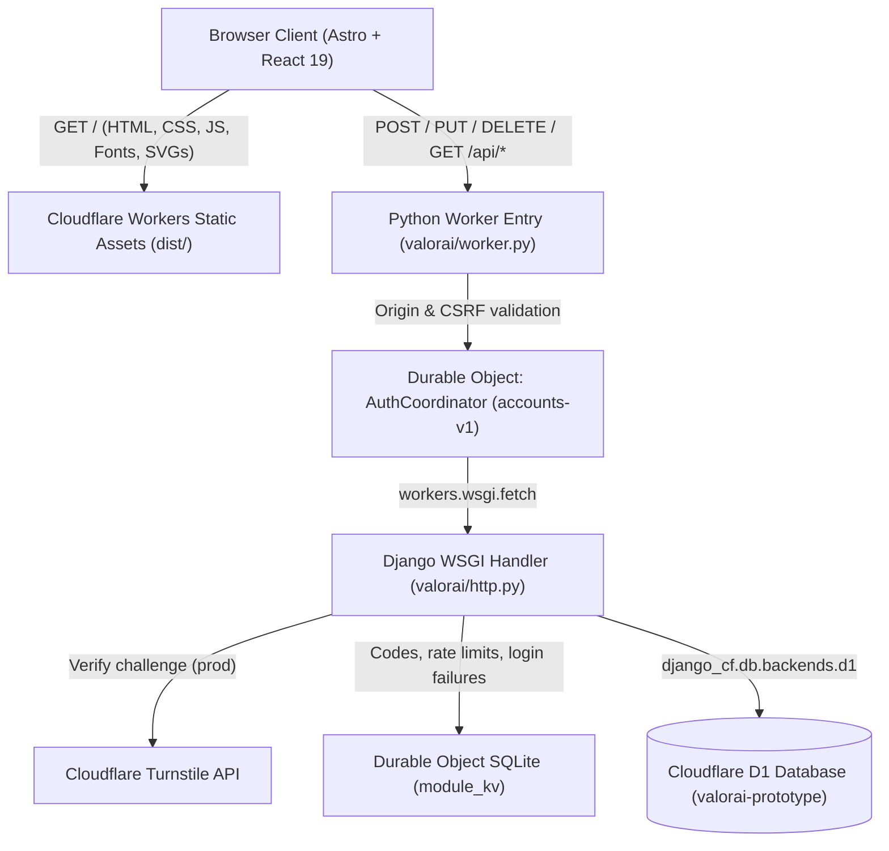
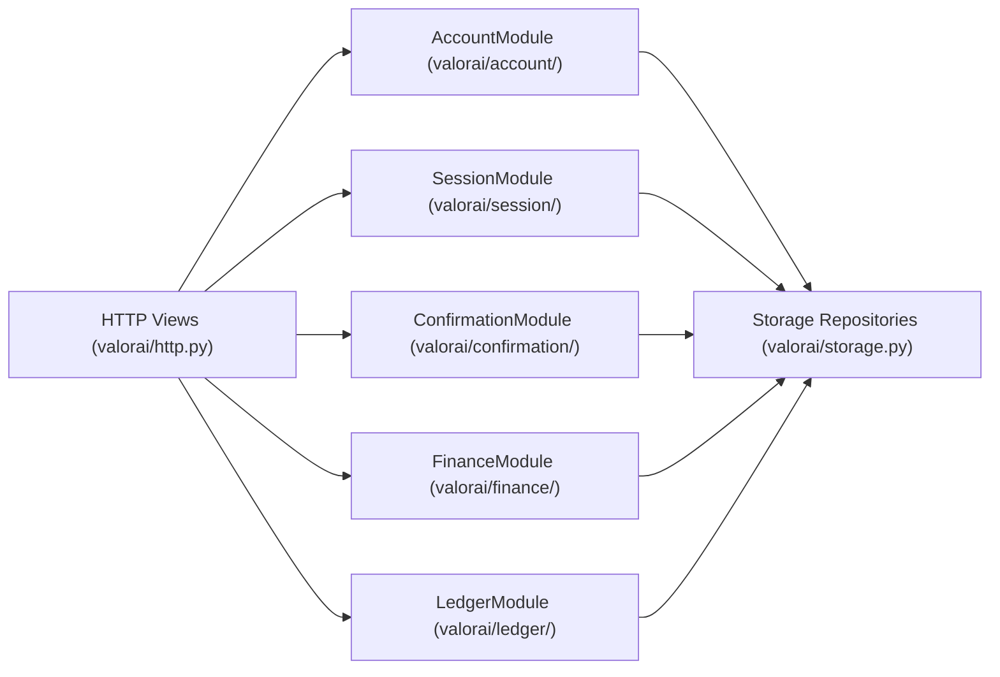

# ValorAI — System Architecture

This document describes the architecture of the **ValorAI** platform (by Nulfinance Inc.), covering its frontend workspace, shared validation layer, Cloudflare Python Worker + Durable Object + D1 backend, domain modules, data model, and security/requirements boundaries.

> **Requirements Baseline**: Detailed business rules and requirements history are maintained in [`docs/Ata_de_Reuniao_ValorAl_v1.3.docx`](docs/Ata_de_Reuniao_ValorAl_v1.3.docx) and [`docs/valorai_requisitos.docx`](docs/valorai_requisitos.docx). Architectural decisions are recorded in [`docs/adr/`](docs/adr/):
> - [ADR 0001: Django on Python Workers](docs/adr/0001-django-workers-architecture.md)
> - [ADR 0002: Operational Dashboard, Financial Ledger Module, and Stitch Workspace](docs/adr/0002-dashboard-ledger-and-stitch-workspace.md)

---

## 1. High-Level Topology

ValorAI runs entirely on the Cloudflare edge network using **Workers Static Assets**, a **Python Worker** running **Django** (`workers-py` / `pywrangler`), a singleton **Durable Object** (`AuthCoordinator` / `accounts-v1`) for stateful coordination and `bcrypt` hashing, and **Cloudflare D1** (SQLite at the edge) for relational persistence.

### Request Flow
1. **Static Assets (`dist/`)**: Astro pre-renders the shell (`src/pages/index.astro`) and bundles the interactive React 19 client application (`src/components/RegistrationApp.tsx` and `src/components/DashboardWorkspace.tsx`). Static requests are served directly from Cloudflare's edge CDN.
2. **Edge Worker Gatekeeper (`server/python/valorai/worker.py`)**:
   - Enforces same-origin verification on state-changing HTTP methods (`POST`, `PUT`, `DELETE`).
   - Forwards `/api/*` requests to the `AuthCoordinator` Durable Object (`accounts-v1`).
3. **Durable Object Coordinator (`AuthCoordinator`)**:
   - Hosts the Django WSGI application (`server/python/valorai/http.py`) and serializes security-sensitive operations.
   - Executes `bcrypt` password hashing (cost factor `10`) within the Durable Object execution budget.
   - Manages ephemeral security state (single-use confirmation codes, resend cooldowns, login failure lockouts, and IP/account rate-limiting counters) inside its private SQLite table (`module_kv`).
4. **Relational Persistence (Cloudflare D1)**:
   - Stores accounts, sessions (SHA-256 token hashes), financial profiles, financial goals, multi-channel transactions, spending limits, educational guides, lesson progress, and audit logs.

---

## 2. Backend Domain Architecture

Rather than coupling business logic to HTTP views or ORM models, the Python backend in `server/python/valorai/` is organized into **five explicit domain modules** backed by repository adapters (`server/python/valorai/storage.py`) and immutable dataclasses (`server/python/valorai/records.py`).

### Domain Modules

| Module | Path | Responsibilities & Requirements Coverage |
| :--- | :--- | :--- |
| **Account** | `server/python/valorai/account/` | **RF001, RF003, RF005, RF006**: Registration validation (CPF check digits, 16+ age verification, address, optional PNG/JPEG avatar ≤ 2 MB), credential verification via injected `Hasher`, profile maintenance (`update_profile` keeping `cpf` and `email` immutable), and logical account deactivation (`inactive` status preserving historical records). |
| **Session** | `server/python/valorai/session/` | **RF006, RF007**: Generates cryptographically random session tokens, sets `HttpOnly`, `SameSite=Strict`, `Secure` cookies (`valorai_session`), stores only SHA-256 token hashes in D1, enforces a 30-minute idle timeout and 12-hour absolute cap, and revokes sessions on logout or deactivation. |
| **Confirmation** | `server/python/valorai/confirmation/` | **RF002**: Manages single-use 6-digit confirmation codes (10-minute TTL, max 5 attempts, 60-second resend cooldown, max 3 issuances/hour) scoped to `code:` keys in the coordinator's `module_kv`. Confirmed accounts transition to `demo_confirmed` (`emailVerified: false`). |
| **Finance** | `server/python/valorai/finance/` | **RF004**: Validates and persists monthly income estimates, fixed monthly expenses, and initial financial goals (`emergency_reserve`, `reduce_expenses`, `clear_debts`, `organize_budget`, `invest`), converting currency amounts to integer cents. |
| **Ledger** | `server/python/valorai/ledger/` | **Operational Financial Management**: Handles the 3 transaction ingestion channels (`manual`, `import_file` CSV/OFX, `receipt_ai` OCR extraction), keyword-based category auto-classification, configurable spending limits (`daily`, `weekly`, `monthly`) with non-blocking alerts, goal contributions, and educational guide progress tracking. |

### Seam & Adapter Pattern (`SqliteDb` vs. `DjangoDb`)
All repositories in `server/python/valorai/storage.py` (`SqlAccounts`, `SqlSessions`, `SqlFinance`, `SqlLessons`, `SqlLedger`) depend on a minimal database protocol (`query` and `execute`):
- **In-Process Unit Tests (`SqliteDb`)**: Runs against an in-memory Python `sqlite3` connection (`uv run pytest` executes 22 tests in ~1 second without requiring a browser or Worker runtime).
- **Cloudflare Worker Runtime (`DjangoDb`)**: Translates `?` placeholders to `%s` so `django_cf.db.backends.d1` properly binds parameters (including `None` → `null` replacements) against Cloudflare D1.

---

## 3. Database Schema (Cloudflare D1 & Durable Object SQLite)

Schema migrations live in `server/migrations/` and are applied via `pywrangler d1 migrations apply`:

- **`0001_initial.sql`**:
  - `accounts`: Identity, personal/address fields, `password_hash`, `status` (`pending`, `demo_confirmed`, `inactive`), `avatar_data_url`, and timestamps.
  - `sessions`: `token_hash` (SHA-256), `account_id`, `expires_at`, `last_active_at`, `revoked_at`.
  - `financial_profiles`: `account_id`, `monthly_income_cents`, `fixed_expenses_cents`, `primary_objective`.
  - `financial_goals`: `account_id`, `objective`, `name`, `target_amount_cents`, `current_amount_cents`, `target_date`.
  - `educational_lessons`: Pre-seeded financial education guides (`Client` is the only system role; no admin backoffice exists).
  - `audit_events`: Append-only security and domain event log. Data changes are written by generic triggers (migration `0009_generic_audit.sql`) as `<table>.<insert|update|delete>` (for example `transactions.delete`) with the changed row in `entity_id`, plus `accounts.status.demo_confirmed` and `accounts.status.inactive`. Login, goal progress, lesson progress and demo seeding events are written by the application (`login_succeeded`, `login_failed`, `goal_progress_updated`, `lesson_progress_updated`, `demo_cycle_seeded`). See [ADR 0005](./docs/adr/0005-generic-audit-triggers.md).
- **`0002_dashboard_ledger.sql`**:
  - `financial_transactions`: Multi-channel ledger (`entry_channel` ∈ `['manual', 'import_file', 'receipt_ai']`, `direction` ∈ `['income', 'expense']`, `amount_cents`, mandatory `category`, `merchant`, `merchant_doc`, `confidence`, `external_ref`, `notes`, `occurred_on`).
  - `spending_limits`: Category budgets per period (`daily`, `weekly`, `monthly`) with `limit_cents` and `active` flag.
  - `lesson_progress`: Per-account completion tracking (`progress_pct`, `completed`) for seeded educational guides.

> **Note on D1 Transactions**: `django-cf` 0.2.17 sets `supports_transactions = False`. Audit events for data changes are therefore written by database triggers in the same statement as the change ([ADR 0003](./docs/adr/0003-database-owned-audit-trail.md), [ADR 0005](./docs/adr/0005-generic-audit-triggers.md)). Only events with no row change (login, lessons, demo seeding) are written by the application after the primary write.

---

## 4. Frontend & Design System Architecture

The frontend is built with **Astro 6**, **React 19**, **Lucide icons**, and **NumberFlow**, sharing deterministic validation schemas (`shared/validation.ts` via **Zod**) with the backend rules.

### Component Hierarchy
- `src/pages/index.astro`: Document shell, self-hosted `Instrument Sans` typography, and root hydration mount.
- `src/components/RegistrationApp.tsx`: Authentication, multi-step onboarding wizard (`Dados pessoais` → `Acesso` → `Confirmação simulada` → `Perfil financeiro`), demo inbox drawer, and session state machine.
- `src/components/DashboardWorkspace.tsx`: Authenticated Stitch Dashboard workspace providing:
  - **Top Navigation Bar & Responsive Mobile Drawer**: Switches between `Visão Geral`, `Transações & Extratos`, `Planejamento & Metas`, and `Guias Práticos`, plus the `RF003` profile maintenance modal and session logout.
  - **3-Column Asymmetric Bento Grid (`Visão Geral`)**:
    - *Dark Emerald Hero Balance Card (`#14281D`)*: Projected free balance, monthly income, monthly expenses, and income commitment badge.
    - *Primary Goal Card*: Progress bar (`<progress>`) and quick contribution action (`+ Registrar aporte`).
    - *Configurable Limit & Alert Card*: Real-time spending gauge and non-blocking alert badges (`No ritmo`, `Atenção (80%+)`, `Limite atingido`, `Limite excedido`).
    - *Category Allocation & Multi-Channel Dropzones*: Horizontal category breakdown alongside AI Receipt OCR (`receipt_ai`) and OFX/CSV (`import_file`) quick triggers.
    - *Recent Ledger & Seeded Guides*: Latest transactions with entry-channel badges and interactive financial education cards.
  - **Declarative Native Modals**: Uses `<dialog closedby="any">` for accessible light-dismiss across Manual Transaction entry, AI Receipt OCR review/confirmation, OFX/CSV statement import, Goal Contribution, Guide Reader, and `RF003` Profile Maintenance.

### Stitch Design System (`.stitch/DESIGN.md`)
The visual language implements the **"Warm Financial Sanctuary"** aesthetic defined in `.stitch/DESIGN.md`:
- **Surfaces**: Warm Alabaster canvas (`#F7F6F2`), Pure Ivory elevated cards (`#FFFFFF`), Stone Mist subtle containers (`#EFECE6`), and Deep Forest Emerald hero card (`#14281D`).
- **Accents & Semantic Tokens**: Brand Sage (`#7E9F8C`), Deep Sage action primary (`#2E5A44`), Warm Amber warnings (`#B45309`), and Terracotta Crimson non-blocking limit alerts (`#B91C1C`).
- **Tabular Numerals**: All currency figures, percentages, and dates enforce `font-variant-numeric: tabular-nums`.

---

## 5. API Surface Summary

| Endpoint | Methods | Description |
| :--- | :--- | :--- |
| `/api/config` | `GET` | Environment mode and Turnstile public site key. |
| `/api/session` | `GET` | Current authenticated account, financial profile, goal, seeded lessons, and demo inbox metadata. |
| `/api/register` | `POST` | Registers a new account (`RF001`) and issues a single-use confirmation code. |
| `/api/confirm-email` | `POST` | Validates the 6-digit code (`RF002`) and transitions the account to `demo_confirmed`. |
| `/api/resend-confirmation` | `POST` | Enforces cooldown/hourly caps and issues a fresh confirmation code. |
| `/api/demo-inbox` | `GET` | Returns the simulated confirmation code strictly to the pending account's own session. |
| `/api/login` / `/api/logout` | `POST` | Authenticates via CPF/email + password (`RF006`) or revokes the active session (`RF007`). |
| `/api/profile` | `PUT` | Updates editable personal, address, and avatar fields (`RF003`). |
| `/api/financial-profile` | `POST` | Saves monthly income, fixed expenses, and primary financial objective (`RF004`). |
| `/api/deactivate` | `POST` | Logically deactivates the account (`RF005`), preserving ledger data and revoking sessions. |
| `/api/dashboard` | `GET` | Aggregated workspace payload: cycle summary, transactions, category breakdown, limits/alerts, goal, and lessons. |
| `/api/transactions` | `POST`, `PUT`, `DELETE` | Manual transaction CRUD with mandatory category and non-blocking limit evaluation. |
| `/api/transactions/import` | `POST` | Parses and imports **OFX** and **CSV** bank statements with auto-classification. |
| `/api/transactions/receipt` | `POST` | Extracts merchant, CNPJ, date, amount, and category from receipt uploads (`extractOnly` preview or save). |
| `/api/limits` | `POST`, `DELETE` | Creates/updates or removes configurable category spending limits (`daily`, `weekly`, `monthly`). |
| `/api/goal` | `POST` | Updates the primary financial goal or records a monetary contribution (`addContribution`). |
| `/api/lessons/progress` | `POST` | Updates reading progress (`progressPct`, `completed`) for seeded educational guides. |

---

## 6. Architecture Decision Records (ADRs)

- **[ADR 0001 — Django on Python Workers](docs/adr/0001-django-workers-architecture.md)**: Explains the migration to Django inside a Cloudflare Python Worker, the `AuthCoordinator` Durable Object for `bcrypt` cost 10 and rate-limiting state, and the four initial domain modules.
- **[ADR 0002 — Operational Dashboard, Financial Ledger Module, and Stitch Workspace](docs/adr/0002-dashboard-ledger-and-stitch-workspace.md)**: Documents the `LedgerModule`, the `0002_dashboard_ledger.sql` D1 migration, multi-channel transaction ingestion (manual, CSV/OFX, receipt OCR), configurable non-blocking spending alerts, `RF003` profile maintenance, the `DjangoDb` null-parameter binding fix, and the Stitch Bento workspace.
