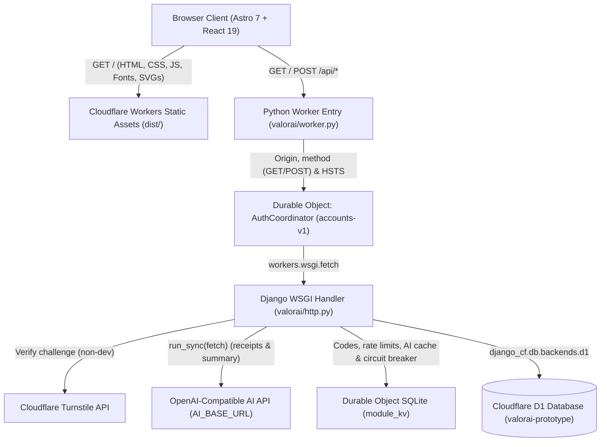
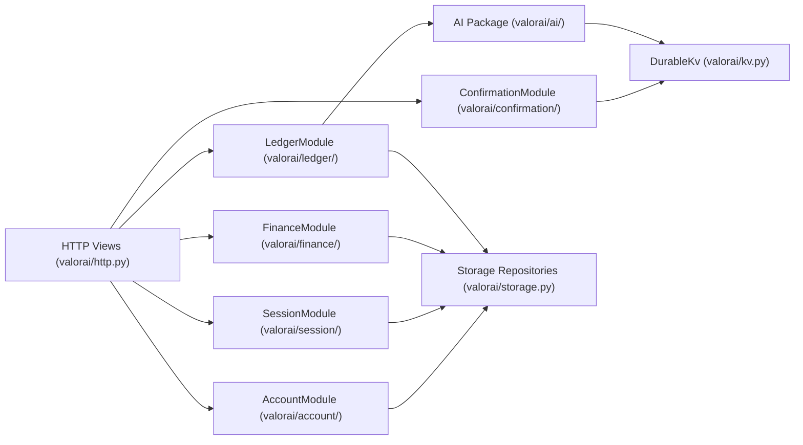

# ValorAI — System Architecture

This document describes the architecture of the **ValorAI** platform (by Nulfinance Inc.), covering its frontend workspace, shared validation layer, Cloudflare Python Worker + Durable Object + D1 backend, AI integration, domain modules, database schema, and security/requirements boundaries.

> **Requirements Baseline**: Detailed business rules and requirements are maintained in [`docs/valorai_requisitos.docx`](docs/valorai_requisitos.docx). Architectural decisions are recorded in [`docs/adr/`](docs/adr/):
> - [ADR 0001: Django on Python Workers](docs/adr/0001-django-workers-architecture.md)
> - [ADR 0002: Operational Dashboard, Financial Ledger Module, and Stitch Workspace](docs/adr/0002-dashboard-ledger-and-stitch-workspace.md)
> - [ADR 0003: Database-Owned Audit Trail and Integrity Triggers](docs/adr/0003-database-owned-audit-trail.md)
> - [ADR 0004: Client-Side Markdown Rendering and Migration-Seeded Financial Guides](docs/adr/0004-markdown-guides-and-migration-seed.md)
> - [ADR 0005: Generic Audit Triggers Rendered From One Template](docs/adr/0005-generic-audit-triggers.md)
> - [ADR 0006: Conformance Fixes for Requirements Revision 1.4](docs/adr/0006-requirements-1-4-conformance.md)
> - [ADR 0007: OpenAI-Compatible AI Integration for Receipt Extraction and Condensed Financial Summaries](docs/adr/0007-openai-compatible-ai-integration.md)
> - [ADR 0008: Password Recovery, Authenticated Password Change, Weekly Budget Limits, and Resend Email Delivery](docs/adr/0008-password-recovery-weekly-limits-and-resend-email.md)

---

## 1. High-Level Topology

ValorAI runs on the Cloudflare edge network using **Workers Static Assets**, a **Python Worker** running **Django** (`workers-py` / `pywrangler`), a singleton **Durable Object** (`AuthCoordinator` / `accounts-v1`) for stateful coordination and `bcrypt` hashing, **Cloudflare D1** (SQLite at the edge) for relational persistence, and an optional **OpenAI-Compatible AI** provider (`AI_BASE_URL`).

### Request Flow
1. **Static Assets (`dist/`)**: Astro pre-renders the shell (`src/pages/index.astro`) and bundles the interactive React 19 client application (`src/components/RegistrationApp.tsx` and `src/components/DashboardWorkspace.tsx`). Static requests are served directly from Cloudflare's edge CDN.
2. **Edge Worker Gatekeeper (`server/python/valorai/worker.py`)**:
   - Enforces same-origin verification on `POST` requests and rejects HTTP methods other than `GET` and `POST` (`405`).
   - Attaches security headers including `Strict-Transport-Security` (HSTS, ADR 0006) and `Cache-Control: no-store` on authenticated API responses.
   - Forwards `/api/*` requests to the `AuthCoordinator` Durable Object (`accounts-v1`), injecting `worker_http_post` (`run_sync(fetch(...))`) for synchronous outbound AI HTTP calls.
3. **Durable Object Coordinator (`AuthCoordinator`)**:
   - Hosts the Django WSGI application (`server/python/valorai/http.py`) and serializes requests synchronously (no `await` in domain code).
   - Executes `bcrypt` password hashing (cost factor `10`).
   - Manages ephemeral state inside its private SQLite table (`module_kv`): single-use confirmation codes, resend cooldowns, login failure lockouts, IP rate-limiting counters, cached AI summaries, and the AI `429` circuit breaker.
4. **Relational Persistence (Cloudflare D1)**:
   - Stores accounts (including financial profile and goal balance), sessions (SHA-256 token hashes), profile change history, multi-channel transactions, budget limits, Markdown educational guides, lesson progress, `audit_context`, and append-only `audit_events`.

---

## 2. Backend Domain Architecture

The Python backend in `server/python/valorai/` separates business logic from HTTP views (`valorai/http.py`) and database adapters (`valorai/storage.py`) using five domain modules plus the `ai` package, operating over immutable dataclasses (`valorai/records.py`).

### Modules & Packages

| Module / Package | Path | Responsibilities & Requirements Coverage |
| :--- | :--- | :--- |
| **Account** | `server/python/valorai/account/` | **RF001, RF003, RF005, RF006, RF008, RF009**: Registration validation (CPF check digits, 16+ age verification, address, optional JPG/PNG/WebP avatar ≤ 2 MB), credential verification via injected `Hasher`, profile maintenance (`update_profile` keeping `cpf` and `email` immutable), password recovery (`recover_password`), authenticated password change (`change_password`), and logical account deactivation (`inactive` status). |
| **Session** | `server/python/valorai/session/` | **RF006, RF007**: Cryptographically random session tokens, `HttpOnly`/`SameSite=Strict`/`Secure` cookies (`valorai_session`), SHA-256 token hashes in D1, 30-minute idle timeout, 12-hour absolute cap, and session revocation on logout, password change/recovery, or deactivation. |
| **Confirmation & Mailer** | `server/python/valorai/confirmation/`, `mailer.py` | **RF002, RF008**: Single-use 6-digit confirmation codes (`code:`, 10-min TTL, 5 attempts, 60s cooldown, 3/hour) and segregated recovery codes (`recovery:`, 15-min TTL, 5 attempts, 60s cooldown, 5/hour) stored in `module_kv`. Supports `EMAIL_MODE=demo` (simulated inbox) and `EMAIL_MODE=resend` (`ResendMailer` via `mail.noti0ns.dev`). |
| **Finance** | `server/python/valorai/finance/` | **RF004**: Validates and persists monthly income estimates, fixed monthly expenses, and financial objectives (`reserve`, `reduce`, `debts`, `organize`, `invest`) in integer cents. |
| **Ledger** | `server/python/valorai/ledger/` | **Operational Financial Management**: Handles the 3 transaction ingestion channels (`manual`, `import` CSV/OFX, `photo` receipt scan), enforces the 10 standardized categories with keyword auto-suggestion, evaluates configurable spending limits (`category`, `daily`, `weekly`, `card_share`) across 4 non-blocking alert levels (`ok`, `warning`, `reached`, `exceeded`), records goal contributions, and tracks guide progress. |
| **AI** | `server/python/valorai/ai/` | **AI Integration (`client.py`, `receipt.py`, `advisor.py`)**: Provider-agnostic OpenAI-Compatible client (`json_schema` strict mode). `AiReceiptExtractor` parses multimodal payment proofs with a 60s HTTP-`429` circuit breaker and heuristic fallback. `FinancialAdvisor` generates PII-free condensed summaries cached in `DurableKv` and revalidated **exclusively by material premises** (`should_regenerate_summary`, no TTL). |

### Seam & Adapter Pattern (`SqliteDb` vs. `DjangoDb`)
All repositories in `server/python/valorai/storage.py` (`SqlAccounts`, `SqlSessions`, `SqlFinance`, `SqlLessons`, `SqlLedger`, `SqlAudit`) depend on a minimal synchronous protocol (`query` and `execute`):
- **In-Process Unit Tests (`SqliteDb`)**: Runs against an in-memory Python `sqlite3` connection (`uv run --directory server/python pytest` executes 46 tests in < 1 s without requiring a browser or Worker runtime).
- **Cloudflare Worker Runtime (`DjangoDb`)**: Translates `?` placeholders to `%s` and `None` to `null` for `django_cf.db.backends.d1`.

---

## 3. Database Schema, Views & Triggers (Cloudflare D1)

Schema migrations live in `server/migrations/` (`0001` through `0011`) and are applied via `pywrangler d1 migrations apply`:

- **Core Tables (`0001_initial.sql`, `0002_dashboard_ledger.sql`, `0003_audit_triggers.sql`)**:
  - `accounts`: Identity, personal/address fields, `password_hash`, `status` (`pending`, `demo_confirmed`, `inactive`), `avatar_data`, financial profile (`income`, `fixed_expenses`, `goal`, `goal_target_cents`, `goal_current_cents`, `goal_monthly_cents`), and timestamps.
  - `sessions`: `token_hash` (SHA-256), `account_id`, `expires_at`, `last_active_at`, `revoked_at`.
  - `profile_changes`: Append-only record of edited profile fields (`RF003`).
  - `transactions`: Multi-channel ledger (`channel` ∈ `['manual', 'import', 'photo']`, `kind` ∈ `['income', 'fixed_expense', 'variable_expense']`, `amount_cents`, mandatory standardized `category`, `merchant_doc`, `confidence`, `status`, `payment_method`, `goal_contribution`, `external_ref`, `occurred_on`).
  - `budget_limits`: Configurable spending limits (`scope` ∈ `['category', 'daily', 'weekly', 'card_share']` via `0011_weekly_limit_scope.sql`, `category`, `limit_cents`, `warn_percent`).
  - `lessons` & `lesson_progress`: Pre-seeded Markdown financial education guides (9 guides via `0006_rich_markdown_lessons.sql` and `0007_lesson_categories_and_more_guides.sql`; `Client` is the only system role with no admin UI) and per-account completion tracking.
  - `audit_context` & `audit_events`: One-row request context table (`id = 1`, `ip_hash`, `at`) and append-only audit log (`BEFORE UPDATE`/`DELETE` triggers raise `ABORT`).
- **Views (`0008_views.sql`)**: `v_account_financial_summary` and `v_monthly_category_spending`.
- **Standard Categories (`0010_standard_categories.sql`)**: Enforces the 10 standardized categories (`Alimentação`, `Moradia`, `Transporte`, `Lazer`, `Educação`, `Saúde`, `Serviços`, `Renda`, `Investimentos`, `Outros`).
- **Database-Owned Audit & Integrity Triggers (`0004`, `0009_generic_audit.sql`)**:
  - `django-cf` 0.2.17 sets `supports_transactions = False`. Data-change audit events are therefore written atomically by SQLite triggers generated from one template (`server/tools/audit_triggers.py` → `0009_generic_audit.sql`) as `<table>.<insert|update|delete>` with `entity_id`, plus `accounts.status.demo_confirmed` and `accounts.status.inactive`.
  - `RegistrationApi.handle` calls `audit.bind(ip_hash, clock.now())` before each request and `audit.unbind()` in a `finally` block so stray writes are visibly `unbound`.
  - Integrity triggers (`0004_goal_and_session_triggers.sql`) maintain `accounts.goal_current_cents` on `goal_contribution` transaction changes and revoke/block sessions atomically when `accounts.status` becomes `'inactive'`.
  - Application-recorded events (`login_succeeded`, `login_failed`, `goal_progress_updated`, `lesson_progress_updated`, `demo_cycle_seeded`) remain in `SqlAudit.record`.

---

## 4. Frontend & Design System Architecture

The frontend is built with **Astro 7**, **React 19**, **Motion**, **Lucide icons**, and **NumberFlow**, sharing deterministic validation schemas (`shared/validation.ts` via **Zod**) with the backend.

### Component Hierarchy
- `src/pages/index.astro`: Document shell, self-hosted `Instrument Sans` typography, and root hydration mount.
- `src/components/RegistrationApp.tsx`: Authentication, multi-step onboarding wizard (`Dados pessoais` → `Acesso` → `Confirmação simulada` → `Perfil financeiro`), demo inbox drawer, and session state machine.
- `src/components/DashboardWorkspace.tsx`: Authenticated Stitch Dashboard workspace providing:
  - **Top Navigation Bar & Responsive Mobile Drawer**: Switches between `Visão Geral`, `Transações & Extratos`, `Planejamento & Metas`, and `Guias Práticos`, plus the `RF003` profile maintenance modal, theme toggle (`ThemeToggle.tsx`), and session logout.
  - **3-Column Asymmetric Bento Grid (`Visão Geral`)**:
    - *Dark Emerald Hero Balance Card (`#14281D`)* + *AI Financial Summary Card*: Displays `dashboard.aiSummary` immediately (cached AI summary or deterministic fallback) with shimmer reveal and triggers background `POST /api/ai/summary` only when `aiSummaryNeedsRefresh` is true, plus a `free_prototype` privacy notice when `aiTier === "free_prototype"`.
    - *Primary Goal Card*, *Configurable Limit & Alert Card* (4 non-blocking levels), *Category Allocation & Multi-Channel Dropzones*, and *Recent Ledger & Seeded Guides*.
  - **Client-Side Receipt Compression**: `compressReceiptImage` resizes receipt/camera photos on `<canvas>` (max `1280px`, JPEG `0.78` stepping down to `0.62` if > 480 KB base64) before `POST /api/transactions/receipt`.
  - **Declarative Native Modals**: Uses `<dialog closedby="any">` for accessible light-dismiss across Manual Transaction entry, AI Receipt review/confirmation, OFX/CSV statement import, Goal Contribution, Guide Reader, and `RF003` Profile Maintenance.
- `src/components/MarkdownContent.tsx`: Zero-dependency JSX Markdown renderer for migration-seeded guides without `dangerouslySetInnerHTML`.

### Design System (`.stitch/DESIGN.md` & `src/styles/global.css`)
- Implements the **"Warm Financial Sanctuary"** light theme (`#F7F6F2` canvas, `#FFFFFF` cards, `#14281D` hero emerald, `#7E9F8C` sage) and a corresponding `[data-theme="dark"]` token set persisted in `localStorage['valorai-theme']`.
- Enforces `font-variant-numeric: tabular-nums` on monetary figures, percentages, and dates.

---

## 5. API Surface Summary

Only `GET` and `POST` reach the API (`405` otherwise). Mutations use `POST` with an `action` field where applicable.

| Endpoint | Method | Description |
| :--- | :--- | :--- |
| `/api/config` | `GET` | Environment mode, Turnstile public site key, and AI metadata (`aiEnabled`, `aiTier`, `aiModel`). |
| `/api/session` | `GET` | Current authenticated account, financial profile, goal, seeded lessons, and demo inbox metadata. |
| `/api/demo-inbox` | `GET` | Returns the simulated confirmation code strictly to the pending account's own session. |
| `/api/lessons` | `GET` | Lists migration-seeded Markdown educational guides. |
| `/api/dashboard` | `GET` | Aggregated workspace payload: cycle summary, transactions, category breakdown, limits/alerts, goal, lessons, `aiSummary`, and `aiSummaryNeedsRefresh`. |
| `/api/register` | `POST` | Registers a new account (`RF001`) and issues a single-use confirmation code. |
| `/api/confirm` | `POST` | Validates the 6-digit code (`RF002`) and transitions the account to `demo_confirmed`. |
| `/api/resend` | `POST` | Enforces cooldown/hourly caps and issues a fresh confirmation code. |
| `/api/login` / `/api/logout` | `POST` | Authenticates via CPF/email + password (`RF006`) or revokes the active session (`RF007`). |
| `/api/recovery/request` | `POST` | Issues a segregated 6-digit recovery code (`RF008`) with uniform response; dispatches via Resend when `EMAIL_MODE=resend`. |
| `/api/recovery/demo-inbox` | `POST` | Returns the simulated recovery code in `EMAIL_MODE=demo` (`404` otherwise). |
| `/api/recovery/reset` | `POST` | Validates recovery code, updates password hash (`bcrypt`), and revokes all active sessions (`RF008`). |
| `/api/password` | `POST` | Validates current password, updates password hash (`RF009`), revokes prior sessions, and starts a fresh session. |
| `/api/profile` | `POST` | Updates editable personal, address, and JPG/PNG/WebP avatar fields (`RF003`). |
| `/api/finance` | `POST` | Saves monthly income, fixed expenses, and primary financial objective (`RF004`). |
| `/api/deactivate` | `POST` | Logically deactivates the account (`RF005`), preserving ledger data and revoking sessions. |
| `/api/transactions` | `POST` | Transaction create, update, `delete`, `validate`, and `seed_demo` via `action` with mandatory standardized category. |
| `/api/transactions/import` | `POST` | Parses and imports **OFX** and **CSV** bank statements with category auto-classification. |
| `/api/transactions/receipt` | `POST` | Extracts transaction fields from receipt images via `AiReceiptExtractor` (`extractOnly` preview or save). |
| `/api/ai/summary` | `POST` | Generates or returns cached PII-free AI financial summary (`force` optional, 30s cooldown). |
| `/api/limits` | `POST` | Creates/updates or removes (`action: "delete"`) configurable spending limits (`category`, `daily`, `weekly`, `card_share`). |
| `/api/goal` | `POST` | Updates the primary financial goal or records a monetary contribution (`addContribution`). |
| `/api/lessons/progress` | `POST` | Updates reading progress (`progressPct`, `completed`) for seeded educational guides. |

---

## 6. Architecture Decision Records (ADRs)

- **[ADR 0001 — Django on Python Workers](docs/adr/0001-django-workers-architecture.md)**: Django inside a Cloudflare Python Worker, the `AuthCoordinator` Durable Object for `bcrypt` cost 10 and rate-limiting state, and the initial domain modules.
- **[ADR 0002 — Operational Dashboard, Financial Ledger Module, and Stitch Workspace](docs/adr/0002-dashboard-ledger-and-stitch-workspace.md)**: `LedgerModule`, multi-channel transaction ingestion, configurable non-blocking spending alerts, `RF003` profile maintenance, `DjangoDb` null-parameter binding, and the Stitch Bento workspace.
- **[ADR 0003 — Database-Owned Audit Trail and Integrity Triggers](docs/adr/0003-database-owned-audit-trail.md)**: Append-only `audit_events`/`profile_changes`, `audit_context` request binding, and atomic triggers for goal balance and account deactivation session revocation.
- **[ADR 0004 — Client-Side Markdown Rendering and Migration-Seeded Financial Guides](docs/adr/0004-markdown-guides-and-migration-seed.md)**: Idempotent Markdown guide migrations and the zero-dependency `MarkdownContent.tsx` JSX renderer.
- **[ADR 0005 — Generic Audit Triggers Rendered From One Template](docs/adr/0005-generic-audit-triggers.md)**: `server/tools/audit_triggers.py` generator, `0009_generic_audit.sql`, `entity_id` tracking, and per-request `audit.unbind()`.
- **[ADR 0006 — Conformance Fixes for Requirements Revision 1.4](docs/adr/0006-requirements-1-4-conformance.md)**: 10 standardized categories (`0010_standard_categories.sql`), 4 alert levels (`ok`, `warning`, `reached`, `exceeded`), WebP avatars, HSTS, and cross-browser Playwright projects.
- **[ADR 0007 — OpenAI-Compatible AI Integration](docs/adr/0007-openai-compatible-ai-integration.md)**: Provider-agnostic `valorai/ai/` package, multimodal receipt extraction with `<canvas>` compression and `429` circuit breaker, PII-free `FinancialAdvisor` with premise-based `DurableKv` caching, and `free_prototype` transparency.
- **[ADR 0008 — Password Recovery, Weekly Limits, and Resend Email](docs/adr/0008-password-recovery-weekly-limits-and-resend-email.md)**: Segregated `RF008` recovery and `RF009` password change flows, `weekly` limit scope (`0011_weekly_limit_scope.sql`), and `ResendMailer` transactional delivery via `mail.noti0ns.dev`.
